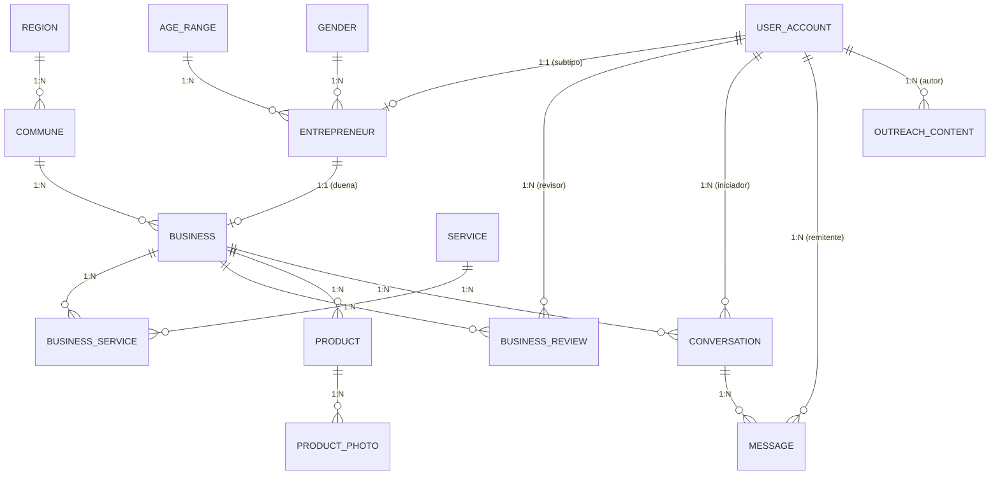

# Modelo de Base de Datos — Fundación Textil Circular

Documento técnico del modelo relacional local implementado en la aplicación Android mediante **Room Database (SQLite)**.

---

## 1. Especificaciones Técnicas

- **Motor:** SQLite gestionado a través de Android Jetpack Room (`2.8.5`).
- **Nombre de archivo SQLite:** `textil_circular.db`
- **Versión actual de esquema:** `1` (`exportSchema = true`)
- **Clase Database:** [`AppDatabase.kt`](file:///Users/bxqx/Proyectos/00_Activos/Proyecto-Textil-Circular/Proyecto-Fundacion-Textil/app/src/main/java/cl/textilcircular/app/core/data/local/AppDatabase.kt)
- **Convertidores de tipo (`TypeConverters`):** [`Converters.kt`](file:///Users/bxqx/Proyectos/00_Activos/Proyecto-Textil-Circular/Proyecto-Fundacion-Textil/app/src/main/java/cl/textilcircular/app/core/data/local/Converters.kt)
  - `Instant` $\leftrightarrow$ `Long` (milisegundos epoch UTC)
  - `Enum` $\leftrightarrow$ `String` (`name`)
- **Inicialización de datos:** Semilla automática en primer arranque vía `DatabaseSetup` desde archivos JSON en `app/src/main/assets/seed/`.

---

## 2. Diagrama Entidad-Relación (ERD)



---

## 3. Diccionario de Datos

### 3.1. Núcleo de Cuentas y Emprendedoras

#### Tabla: `USER_ACCOUNT`
Entidad principal para autenticación, control de acceso y estado de cuenta.

| Campo | Tipo Room / SQLite | Restricciones | Valor por Defecto | Descripción |
| :--- | :--- | :--- | :--- | :--- |
| `user_id` | `INTEGER` | **PK**, Auto-generado | `0` | Identificador único del usuario. |
| `email` | `TEXT` | **NOT NULL**, **Unique** (`UK_USER_ACCOUNT_EMAIL`) | — | Correo electrónico de acceso. |
| `password_hash`| `TEXT` | **NOT NULL** | — | Hash de la contraseña. |
| `role` | `TEXT` | **NOT NULL** | — | Rol asignado (`Role`: `CUSTOMER`, `ENTREPRENEUR`, `ADMINISTRATOR`). |
| `alias` | `TEXT` | Nullable | `NULL` | Nombre público o apodo en la plataforma. |
| `status` | `TEXT` | **NOT NULL** | `'ACTIVE'` | Estado de la cuenta (`AccountStatus`: `ACTIVE`, `DEACTIVATED`, `SUSPENDED`, `DELETED`). |
| `consent_at` | `INTEGER` | **NOT NULL** | — | Timestamp UTC de aceptación de términos y privacidad. |
| `created_at` | `INTEGER` | **NOT NULL** | — | Timestamp UTC de creación. |
| `updated_at` | `INTEGER` | **NOT NULL** | — | Timestamp UTC de última modificación. |
| `deactivated_at`| `INTEGER` | Nullable | `NULL` | Timestamp UTC de desactivación temporal. |
| `deleted_at` | `INTEGER` | Nullable | `NULL` | Timestamp UTC de baja lógica (*soft delete*). |

#### Tabla: `ENTREPRENEUR`
Subtipo de `USER_ACCOUNT` (relación 1:1) que almacena datos personales y demográficos de la emprendedora.

| Campo | Tipo Room / SQLite | Restricciones | Valor por Defecto | Descripción |
| :--- | :--- | :--- | :--- | :--- |
| `user_id` | `INTEGER` | **PK**, **FK** → `USER_ACCOUNT(user_id)` | — | Mismo ID que la cuenta de usuario. |
| `age_range_id` | `INTEGER` | **NOT NULL**, **FK** → `AGE_RANGE(age_range_id)` | — | Rango de edad de la emprendedora. |
| `gender_id` | `INTEGER` | **NOT NULL**, **FK** → `GENDER(gender_id)` | — | Identidad de género declarada. |
| `rut` | `TEXT` | Nullable, **Unique** (`UK_ENTREPRENEUR_RUT`) | `NULL` | RUT chileno de la emprendedora. |
| `first_name` | `TEXT` | Nullable | `NULL` | Nombre de pila. |
| `last_name` | `TEXT` | Nullable | `NULL` | Apellidos. |
| `anonymized_at`| `INTEGER` | Nullable | `NULL` | Timestamp UTC de anonimización en cumplimiento de ley de datos. |

---

### 3.2. Fichas de Emprendimientos y Validación

#### Tabla: `BUSINESS`
Ficha del taller o negocio textil circular.

| Campo | Tipo Room / SQLite | Restricciones | Valor por Defecto | Descripción |
| :--- | :--- | :--- | :--- | :--- |
| `business_id` | `INTEGER` | **PK**, Auto-generado | `0` | Identificador único del emprendimiento. |
| `user_id` | `INTEGER` | **NOT NULL**, **FK** → `ENTREPRENEUR(user_id)`, **Unique** (`UK_BUSINESS_USER`) | — | Dueña del taller (máximo 1 taller por emprendedora). |
| `commune_id` | `INTEGER` | **NOT NULL**, **FK** → `COMMUNE(commune_id)`, **Index** (`IX_BUSINESS_COMMUNE`) | — | Comuna donde opera el taller. |
| `name` | `TEXT` | **NOT NULL** | — | Nombre de fantasía del emprendimiento. |
| `description` | `TEXT` | **NOT NULL** | — | Descripción de su propuesta circular, historia o técnicas. |
| `photo_url` | `TEXT` | Nullable | `NULL` | URL o ruta de la imagen de portada/perfil. |
| `status` | `TEXT` | **NOT NULL**, **Index** (`IX_BUSINESS_STATUS`) | `'PENDING'` | Estado de validación (`BusinessStatus`: `PENDING`, `APPROVED`, `REJECTED`). |
| `review_round` | `INTEGER` | **NOT NULL** | `1` | Ciclo actual de revisión comunitaria. |
| `approved_at` | `INTEGER` | Nullable | `NULL` | Timestamp UTC en que fue aprobado para publicación. |
| `hidden_at` | `INTEGER` | Nullable | `NULL` | Timestamp UTC de ocultamiento voluntario del directorio. |
| `created_at` | `INTEGER` | **NOT NULL** | — | Timestamp UTC de registro. |
| `updated_at` | `INTEGER` | **NOT NULL** | — | Timestamp UTC de actualización. |
| `deleted_at` | `INTEGER` | Nullable | `NULL` | Timestamp UTC de eliminación lógica. |

#### Tabla: `BUSINESS_SERVICE`
Tabla intermedia que clasifica a cada taller en uno o más servicios textiles (relación N:M).

| Campo | Tipo Room / SQLite | Restricciones | Valor por Defecto | Descripción |
| :--- | :--- | :--- | :--- | :--- |
| `business_id` | `INTEGER` | **PK compuesta**, **FK** → `BUSINESS(business_id)` | — | Taller asociado. |
| `service_id` | `INTEGER` | **PK compuesta**, **FK** → `SERVICE(service_id)`, **Index** (`IX_BUSINESS_SERVICE_SERVICE`) | — | Servicio ofrecido. |
| `sort_order` | `INTEGER` | **NOT NULL**, **Unique** (`UK_BUSINESS_SERVICE_ORDER` con `business_id`) | — | Orden de visualización en la ficha. |

#### Tabla: `BUSINESS_REVIEW`
Registro del proceso de validación colaborativa (*Peer Review*) entre integrantes de la red o administración.

| Campo | Tipo Room / SQLite | Restricciones | Valor por Defecto | Descripción |
| :--- | :--- | :--- | :--- | :--- |
| `review_id` | `INTEGER` | **PK**, Auto-generado | `0` | Identificador del voto de revisión. |
| `business_id` | `INTEGER` | **NOT NULL**, **FK** → `BUSINESS(business_id)` | — | Ficha del taller evaluado. |
| `reviewer_id` | `INTEGER` | **NOT NULL**, **FK** → `USER_ACCOUNT(user_id)`, **Index** (`IX_BUSINESS_REVIEW_REVIEWER`) | — | Usuario evaluador. |
| `round` | `INTEGER` | **NOT NULL** | — | Número de ronda en la que se emitió el voto. |
| `decision` | `TEXT` | **NOT NULL** | — | Veredicto (`ReviewDecision`: `APPROVED`, `REJECTED`). |
| `comment` | `TEXT` | Nullable | `NULL` | Justificación, sugerencias o retroalimentación. |
| `reviewed_at` | `INTEGER` | **NOT NULL** | — | Timestamp UTC de emisión del voto. |

> **Restricción de unicidad:** `UK_BUSINESS_REVIEW_VOTE` (`business_id`, `reviewer_id`, `round`) garantiza un solo voto por revisor en cada ronda.

---

### 3.3. Catálogo de Productos

#### Tabla: `PRODUCT`
Artículos, prendas o productos textiles ofrecidos por un taller.

| Campo | Tipo Room / SQLite | Restricciones | Valor por Defecto | Descripción |
| :--- | :--- | :--- | :--- | :--- |
| `product_id` | `INTEGER` | **PK**, Auto-generado | `0` | Identificador único del producto. |
| `business_id` | `INTEGER` | **NOT NULL**, **FK** → `BUSINESS(business_id)`, **Index** (`IX_PRODUCT_BUSINESS`) | — | Taller propietario del producto. |
| `title` | `TEXT` | **NOT NULL** | — | Título del producto. |
| `description` | `TEXT` | **NOT NULL** | — | Detalle de confección, materiales y dimensiones. |
| `price` | `INTEGER` | Nullable | `NULL` | Precio referencial en Pesos Chilenos (CLP). |
| `status` | `TEXT` | **NOT NULL** | `'ACTIVE'` | Estado del producto (`ProductStatus`: `ACTIVE`, `HIDDEN`). |
| `created_at` | `INTEGER` | **NOT NULL** | — | Timestamp UTC de creación. |
| `updated_at` | `INTEGER` | **NOT NULL** | — | Timestamp UTC de última edición. |
| `deleted_at` | `INTEGER` | Nullable | `NULL` | Timestamp UTC de eliminación lógica. |

#### Tabla: `PRODUCT_PHOTO`
Galería de imágenes asociadas a un producto.

| Campo | Tipo Room / SQLite | Restricciones | Valor por Defecto | Descripción |
| :--- | :--- | :--- | :--- | :--- |
| `photo_id` | `INTEGER` | **PK**, Auto-generado | `0` | Identificador de la foto. |
| `product_id` | `INTEGER` | **NOT NULL**, **FK** → `PRODUCT(product_id)` | — | Producto al que pertenece la imagen. |
| `url` | `TEXT` | **NOT NULL** | — | URL remota o recurso local de la imagen. |
| `sort_order` | `INTEGER` | **NOT NULL**, **Unique** (`UK_PRODUCT_PHOTO_ORDER` con `product_id`) | — | Posición en la galería (0 = principal). |
| `created_at` | `INTEGER` | **NOT NULL** | — | Timestamp UTC de registro. |

---

### 3.4. Mensajería Directa

#### Tabla: `CONVERSATION`
Hilo de chat entre un cliente y el taller de una emprendedora.

| Campo | Tipo Room / SQLite | Restricciones | Valor por Defecto | Descripción |
| :--- | :--- | :--- | :--- | :--- |
| `conversation_id`| `INTEGER` | **PK**, Auto-generado | `0` | Identificador de la conversación. |
| `initiator_id` | `INTEGER` | **NOT NULL**, **FK** → `USER_ACCOUNT(user_id)` | — | Usuario cliente que inició el contacto. |
| `business_id` | `INTEGER` | **NOT NULL**, **FK** → `BUSINESS(business_id)`, **Index** (`IX_CONVERSATION_BUSINESS`) | — | Taller contactado. |
| `created_at` | `INTEGER` | **NOT NULL** | — | Timestamp UTC de inicio del chat. |

> **Restricción de unicidad:** `UK_CONVERSATION_PAIR` (`initiator_id`, `business_id`) evita hilos duplicados entre el mismo cliente y taller.

#### Tabla: `MESSAGE`
Mensajes individuales dentro de un hilo.

| Campo | Tipo Room / SQLite | Restricciones | Valor por Defecto | Descripción |
| :--- | :--- | :--- | :--- | :--- |
| `message_id` | `INTEGER` | **PK**, Auto-generado | `0` | Identificador del mensaje. |
| `sender_id` | `INTEGER` | **NOT NULL**, **FK** → `USER_ACCOUNT(user_id)` | — | Emisor del mensaje (cliente o dueña del taller). |
| `conversation_id`| `INTEGER` | **NOT NULL**, **FK** → `CONVERSATION(conversation_id)` | — | Hilo al que pertenece. |
| `client_uuid` | `TEXT` | **NOT NULL**, **Unique** (`UK_MESSAGE_CLIENT_UUID`) | — | UUID asignado por el cliente para idempotencia. |
| `content` | `TEXT` | **NOT NULL** | — | Cuerpo del mensaje de texto. |
| `sent_at` | `INTEGER` | **NOT NULL**, **Index** (`IX_MESSAGE_CONVERSATION_SENT` con `conversation_id`) | — | Timestamp UTC de envío. |
| `read_at` | `INTEGER` | Nullable | `NULL` | Timestamp UTC en que el receptor leyó el mensaje. |

---

### 3.5. Difusión Comunitaria

#### Tabla: `OUTREACH_CONTENT`
Contenido público informativo de la fundación (talleres formativos, ferias, noticias, eventos).

| Campo | Tipo Room / SQLite | Restricciones | Valor por Defecto | Descripción |
| :--- | :--- | :--- | :--- | :--- |
| `content_id` | `INTEGER` | **PK**, Auto-generado | `0` | Identificador de la publicación. |
| `author_id` | `INTEGER` | **NOT NULL**, **FK** → `USER_ACCOUNT(user_id)` | — | Usuario autor (habitualmente rol `ADMINISTRATOR`). |
| `type` | `TEXT` | **NOT NULL** | — | Tipo de contenido (`ContentType`: `TEXT`, `IMAGE`, `ARTICLE`, `EVENT`). |
| `title` | `TEXT` | Nullable | `NULL` | Título del evento o publicación. |
| `body` | `TEXT` | Nullable | `NULL` | Contenido en texto o descripción extensa. |
| `image_url` | `TEXT` | Nullable | `NULL` | Afiche o fotografía de apoyo. |
| `event_at` | `INTEGER` | Nullable | `NULL` | Fecha y hora programada del evento o taller. |
| `event_location`| `TEXT` | Nullable | `NULL` | Lugar físico o enlace virtual del evento. |
| `created_at` | `INTEGER` | **NOT NULL**, **Index** (`IX_OUTREACH_CONTENT_CREATED`) | — | Timestamp UTC de creación. |
| `updated_at` | `INTEGER` | **NOT NULL** | — | Timestamp UTC de actualización. |
| `deleted_at` | `INTEGER` | Nullable | `NULL` | Timestamp UTC de eliminación lógica. |

---

### 3.6. Tablas Maestras (Lookup)

#### Tabla: `REGION`
División político-administrativa regional de Chile.
- `region_id` (`INTEGER`, **PK**, Auto-generado)
- `name` (`TEXT`, **NOT NULL**, **Unique**: `UK_REGION_NAME`)
- `sort_order` (`INTEGER`, **NOT NULL**)

#### Tabla: `COMMUNE`
Comunas asociadas a cada región.
- `commune_id` (`INTEGER`, **PK**, Auto-generado)
- `region_id` (`INTEGER`, **NOT NULL**, **FK** → `REGION(region_id)`)
- `name` (`TEXT`, **NOT NULL**)
- **Restricción de unicidad:** `UK_COMMUNE_REGION_NAME` (`region_id`, `name`)

#### Tabla: `SERVICE`
Categorías de servicios textiles circulares (ej. *Upcycling*, *Confección a medida*, *Reparación de prendas*, *Teñido natural*).
- `service_id` (`INTEGER`, **PK**, Auto-generado)
- `name` (`TEXT`, **NOT NULL**, **Unique**: `UK_SERVICE_NAME`)
- `is_active` (`INTEGER` / Boolean, **NOT NULL**, default `1`)

#### Tabla: `AGE_RANGE`
Rangos etarios estadísticos para perfil demográfico de emprendedoras.
- `age_range_id` (`INTEGER`, **PK**, Auto-generado)
- `description` (`TEXT`, **NOT NULL**, **Unique**: `UK_AGE_RANGE_DESCRIPTION`)
- `sort_order` (`INTEGER`, **NOT NULL**)

#### Tabla: `GENDER`
Opciones de género declarativo para perfil demográfico.
- `gender_id` (`INTEGER`, **PK**, Auto-generado)
- `description` (`TEXT`, **NOT NULL**, **Unique**: `UK_GENDER_DESCRIPTION`)

---

## 4. Vistas de Base de Datos

### `V_CATALOG` ([`CatalogView.kt`](file:///Users/bxqx/Proyectos/00_Activos/Proyecto-Textil-Circular/Proyecto-Fundacion-Textil/app/src/main/java/cl/textilcircular/app/core/data/local/entity/CatalogView.kt))
Vista diseñada para acelerar la consulta pública del Directorio garantizando privacidad y consistencia:

```sql
SELECT b.business_id, b.name, b.description, b.photo_url,
       b.commune_id, c.name AS commune_name, c.region_id, r.name AS region_name,
       b.approved_at
FROM BUSINESS b
JOIN USER_ACCOUNT u ON u.user_id = b.user_id
JOIN COMMUNE c ON c.commune_id = b.commune_id
JOIN REGION r ON r.region_id = c.region_id
WHERE b.status = 'APPROVED'
  AND b.deleted_at IS NULL
  AND b.hidden_at IS NULL
  AND u.status = 'ACTIVE'
```

**Principios de seguridad de la vista:**
1. Solo muestra fichas con estado `APPROVED`.
2. Oculta fichas con borrado lógico (`deleted_at IS NOT NULL`) o pausadas (`hidden_at IS NOT NULL`).
3. Oculta fichas si la cuenta de la dueña no está en estado `ACTIVE`.
4. **Protección de datos personales:** No proyecta ni expone el RUT ni el correo electrónico personal de la emprendedora.

---

## 5. Enumeraciones de Dominio ([`Enums.kt`](file:///Users/bxqx/Proyectos/00_Activos/Proyecto-Textil-Circular/Proyecto-Fundacion-Textil/app/src/main/java/cl/textilcircular/app/core/data/local/entity/Enums.kt))

| Enum | Valores Posibles | Uso en BD |
| :--- | :--- | :--- |
| `Role` | `ENTREPRENEUR`, `ADMINISTRATOR`, `CUSTOMER` | `USER_ACCOUNT.role` |
| `AccountStatus` | `ACTIVE`, `DEACTIVATED`, `SUSPENDED`, `DELETED` | `USER_ACCOUNT.status` |
| `BusinessStatus`| `PENDING`, `APPROVED`, `REJECTED` | `BUSINESS.status` |
| `ProductStatus` | `ACTIVE`, `HIDDEN` | `PRODUCT.status` |
| `ReviewDecision`| `APPROVED`, `REJECTED` | `BUSINESS_REVIEW.decision` |
| `ContentType` | `TEXT`, `IMAGE`, `ARTICLE`, `EVENT` | `OUTREACH_CONTENT.type` |

---

## 6. Mapeo de Archivos en el Código Fuente

- **Configuración de Room:** [`AppDatabase.kt`](file:///Users/bxqx/Proyectos/00_Activos/Proyecto-Textil-Circular/Proyecto-Fundacion-Textil/app/src/main/java/cl/textilcircular/app/core/data/local/AppDatabase.kt)
- **Definición de Entidades:** [`app/src/main/java/cl/textilcircular/app/core/data/local/entity/`](file:///Users/bxqx/Proyectos/00_Activos/Proyecto-Textil-Circular/Proyecto-Fundacion-Textil/app/src/main/java/cl/textilcircular/app/core/data/local/entity/)
- **DAOs de Consulta:** [`app/src/main/java/cl/textilcircular/app/core/data/local/dao/`](file:///Users/bxqx/Proyectos/00_Activos/Proyecto-Textil-Circular/Proyecto-Fundacion-Textil/app/src/main/java/cl/textilcircular/app/core/data/local/dao/)
- **Esquema JSON autogenerado (Room v1):** [`1.json`](file:///Users/bxqx/Proyectos/00_Activos/Proyecto-Textil-Circular/Proyecto-Fundacion-Textil/app/schemas/cl.textilcircular.app.core.data.local.AppDatabase/1.json)
- **Módulo de Inyección Hilt:** [`DatabaseModule.kt`](file:///Users/bxqx/Proyectos/00_Activos/Proyecto-Textil-Circular/Proyecto-Fundacion-Textil/app/src/main/java/cl/textilcircular/app/core/data/di/DatabaseModule.kt)
